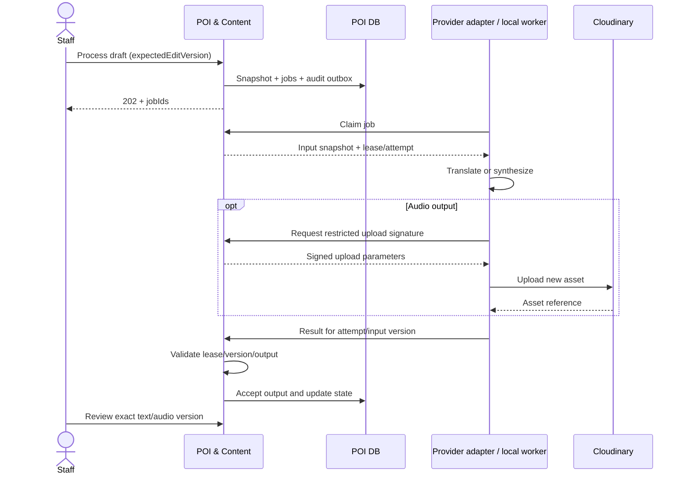

# Vinlook — D-013: hợp đồng nội dung, phiên bản và media

Ngày 23/10/2026. **ĐÃ DUYỆT tại DEC-073**. Cơ sở D-004–007 và D-012 đã duyệt. Truy vết REQ-010–015/018/019/026; UC-012–018. Chưa triển khai pipeline hoặc tạo media thật.

## 1. Đề xuất quản lý phụ thuộc nội dung

Giữ editVersion cho chống sửa đồng thời; bổ sung **sourceVersion** ở POIRevision và **textVersion** ở LocalizedContent. Job lưu input snapshot bất biến và các version liên quan: không đọc lại draft đang thay đổi để xử lý giữa chừng. Audio phải tham chiếu đúng textVersion; bản dịch phải tham chiếu sourceVersion. Đây là trường bổ sung cần duyệt, không được coi editVersion metadata thay đổi là lý do tự chạy lại mọi provider.

| Thay đổi trên draft | Đề xuất mất hiệu lực | Phần được giữ |
|---|---|---|
| Source English | Tăng sourceVersion; English text theo nguồn mới, toàn bộ text/audio phụ thuộc cần kiểm tra lại; không cho publish kết quả từ source cũ | Kết quả cũ còn lưu lịch sử, bản published cũ không đổi |
| Text của một ngôn ngữ | Tăng textVersion; audio cũ ngôn ngữ đó và approval không còn hợp lệ | Các ngôn ngữ khác còn hợp lệ nếu nguồn không đổi |
| Audio/voice của một ngôn ngữ | Approval của ngôn ngữ đó về pending; đo lại thời lượng | Text đúng version, các ngôn ngữ khác |
| Tên/thumbnail/tọa độ/điểm vào | Tăng editVersion và yêu cầu Manager kiểm tra metadata khi publish | Giữ text/audio đúng nguồn; nhân viên phải kiểm tra nội dung có còn khớp metadata, không tự coi metadata sửa là cần gọi lại TTS |

Không tự sửa draft in_review: phải trả về draft theo D-006. Không tự chạy job chỉ vì dữ liệu thay đổi; nhân viên vẫn bấm Process/Retry. Nếu source mới khiến kết quả cũ không hợp lệ, UI ghi stale thay vì xóa âm thầm hoặc tiếp tục hiện approved.

Đề xuất thêm **entrance** (GeoJSON Point) trong revision tách khỏi location: location để đặt marker, entrance để dẫn tới lối vào đã kiểm tra. Khi chưa có entrance hợp lệ, không giả định tâm công trình là lối vào; bản POI chưa đủ điều kiện publish cho dẫn đường. Cần bổ sung index/ràng buộc tương ứng sau khi duyệt trường này.

## 2. Hợp đồng process/retry/result

| API | Request đề xuất | Response/điều kiện |
|---|---|---|
| POST /admin/revisions/:id/process | expectedEditVersion; Idempotency-Key ở header | 202: revisionId, sourceVersion, jobIds, status; 409 khi version sai hoặc đã có job tương đương đang hoạt động |
| POST /admin/jobs/:id/retry | expectedEditVersion; Idempotency-Key | 202: jobId, inputVersion, status; chỉ retry phần lỗi hợp lệ, không dùng snapshot lỗi thời để cập nhật draft mới |
| POST /internal/jobs/claim | caller credential; capability hỗ trợ và workerId | Job hoặc không có việc; job gồm snapshot, versions, attemptId, leaseExpiresAt. Capability không cho worker tự chọn quyền publish |
| POST /internal/jobs/:id/renew | attemptId | Thời hạn mới hoặc 409 stale; dùng thời gian server |
| POST /internal/jobs/:id/result | attemptId, inputVersion, output text hoặc asset reference, kết quả/lỗi | Chỉ nhận lease và snapshot hợp lệ; kết quả lặp đã nhận trả trạng thái tiếp nhận, không tạo output nghiệp vụ thứ hai |

Pipeline 16 ngôn ngữ gồm English source: English không gọi dịch sang chính nó, nhưng vẫn cần text/audio đủ điều kiện. TTS chỉ chạy khi có text đầu vào đúng version. Nigerian Pidgin dùng worker local theo lựa chọn trước; provider/voice/locale thực tế phải được kiểm chứng và cấu hình rõ trước release, không tự thay locale gần giống để tuyên bố đủ 16 ngôn ngữ.

Nếu sửa input khi job đang chạy, job có thể tốn chi phí/quota đã gọi nhưng kết quả cũ không được chấp nhận cho input mới. Không hứa hủy được provider computation. Account/session và audit giữ theo request khởi tạo đã duyệt; worker hoàn thành sau đóng phiên không được gán sang phiên khác.

## 3. Luồng media đề xuất

Ảnh do nhân viên chọn, audio do pipeline tạo. Đề xuất **upload có chữ ký ngắn hạn** do POI service cấp cho caller được phép; không mở upload preset công khai hoặc gửi Cloudinary secret cho frontend/worker. Chữ ký ràng buộc loại/namespace/asset ID theo job hoặc revision; giới hạn thực tế của provider phải xác minh lúc tích hợp.

Sau upload, caller gửi reference về POI service; service xác minh asset thuộc đúng namespace/ý định upload, loại file, dung lượng và metadata thời lượng, không tin URL hay durationSeconds client tự khai. Không cho nhập URL tùy ý rồi server fetch mà chưa có allowlist/validation.

Asset ID mới khi thay nội dung, không overwrite asset đang thuộc bản published hoặc cache offline cũ. Upload xong nhưng DB chưa ghi là asset chưa gắn kết: đánh dấu để đối soát qua job/revision, không tự xóa theo timer trong kỳ giữ dữ liệu đã chốt. Không tự thêm cleanup xóa lịch sử để tiết kiệm quota.

**Tham số mới đề xuất:** thumbnail JPEG/PNG/WebP ≤2 MB, tối đa 1600×1600; audio lưu/phân phối MP3 mono, mục tiêu 64 kbit/s, tối đa 3 MB/file, thời lượng 90–150 giây. Chuyển đổi có thể chạy local trước upload nếu định dạng provider khác, không ngầm thêm dịch vụ phí. Cấu hình này cần kiểm chứng rõ tiếng/giọng cho 16 ngôn ngữ, không coi bitrate đảm bảo chất lượng. Không cho upload SVG/HTML làm thumbnail.

## 4. Review và publish

Review phải gắn expectedEditVersion và đúng textVersion/audio đang nghe. Sửa phần đã duyệt đưa pending theo bảng mục 1. Submit chuyển in_review khi nội dung đã sẵn sàng; Manager publish kiểm tra lại quyền/phiên, metadata/entrance, 16 ngôn ngữ và versions, audio tồn tại/thời lượng, trạng thái không xóa, rồi đổi publishedRevisionId + outbox + idempotency result trong transaction POI DB.

Không có transaction nguyên tử với Cloudinary: asset cần tồn tại trước commit; lỗi media phải để publish thất bại với thông báo và retry. Không giả rằng đã ghi DB là CDN luôn khả dụng; kiểm tra/tái kiểm tra media và xử lý lỗi phát thuộc Test Plan. Chưa chọn cache-control/fallback khi asset provider tạm lỗi.

## 5. Sequence đề xuất

Provider adapter dùng Gemini/Azure không được hiểu là worker MMS tự gánh mọi tác vụ; placement chi tiết các adapter và lịch xử lý phải trình cùng cấu hình tích hợp/quota. Không thêm hosted runtime từ sequence này.

## 6. Nội dung cần duyệt

1. Version/snapshot/invalidation, các trường sourceVersion/textVersion/entrance và process/retry/result contract.
2. Hướng signed upload, asset bất biến và kiểm tra server; không dùng upload công khai/URL tùy ý.
3. Giới hạn thumbnail/audio và MP3 mono mục tiêu 64 kbit/s ở trên để kiểm chứng trước release.

Đây là đề xuất mới về dữ liệu, media và tích hợp, cần duyệt trước khi chốt schema/API. Không xác nhận quota/giọng đọc/240 audio đã đạt, không mở Implementation hoặc Design tổng thể.

## Phê duyệt — DEC-073

Duy duyệt toàn bộ D-013: input versions/snapshot/invalidation và entrance, process/retry/result contract, signed upload/immutable asset/server validation, giới hạn ảnh/audio và MP3 mono mục tiêu 64 kbit/s. Cần kiểm chứng tích hợp/quota/chất lượng trước release; không suy ra Design tổng thể hoặc Implementation đã mở.
