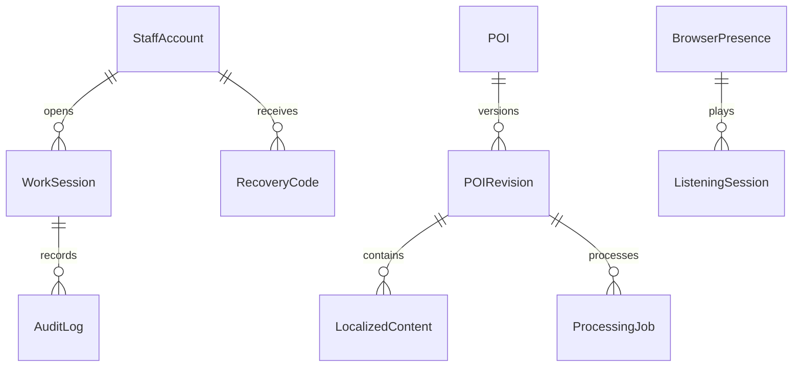

# Vinlook — D-004: đề xuất data model

Ngày 23/10/2026. **ĐÃ DUYỆT tại DEC-054**. Đây là mô hình đề xuất, chưa phải schema Mongoose hay database đã tạo. Cơ sở: DEC-051/052/053; REQ-011–026 và UC-012–032.

## Quy ước đề xuất

ID nội bộ dùng ObjectId; tham chiếu qua service truyền dưới dạng chuỗi ID, không có foreign key xuyên database hoặc truy vấn trực tiếp database khác. Thời điểm lưu UTC; ngày phiên làm việc tính theo Asia/Ho_Chi_Minh. Các trạng thái và trường dưới đây cần duyệt trước khi đặc tả schema chi tiết.

## Identity & Staff

| Collection đề xuất | Trường chính đề xuất | Quan hệ/ràng buộc đề xuất |
|---|---|---|
| StaffAccount | id, fullName, email, passwordHash, role, status, createdAt, updatedAt | Email chuẩn hóa và duy nhất; role Staff/Manager; không lưu confirmPassword |
| WorkSession | id, staffId, workDateVN, status, openedAt, closedAt | Một tài khoản có nhiều phiên; unique(staffId, workDateVN); mở lại cùng bản ghi trong ngày |
| AuditLog | id, eventId, actorId, workSessionId, action, poiId, occurredAt, receivedAt, result | eventId duy nhất chống nhận trùng; poiId là tham chiếu logic; phiên gốc không đổi khi nhận chậm |
| RecoveryCode | id, staffId, codeHash, expiresAt, usedAt, issuedBy | Không lưu mã rõ; kiểm tra hết hạn và đã dùng tại API; thời hạn và cơ chế băm mã chờ thiết kế bảo mật |

## POI & Content

| Collection đề xuất | Trường chính đề xuất | Quan hệ/ràng buộc đề xuất |
|---|---|---|
| POI | id, publishedRevisionId, deletedAt, deletedBy, createdAt | Danh tính ổn định, soft delete; không xóa lịch sử |
| POIRevision | id, poiId, revisionNumber, status, nameEN, location, thumbnailAsset, sourceTextEN, createdBy, createdAt, updatedAt | Một POI nhiều revision; unique(poiId, revisionNumber); chỉnh bản nháp không đổi bản đã công khai |
| LocalizedContent | id, revisionId, languageCode, text, audioAsset, durationSeconds, reviewStatus, reviewedBy, reviewedAt | unique(revisionId, languageCode); bản nháp có 0–16 bản ngôn ngữ, công khai cần đủ 16 bản được duyệt |
| ProcessingJob | id, revisionId, languageCode, taskType, inputVersion, status, attemptId, leaseOwner, leaseExpiresAt, resultRef, error, requestedBy, workSessionId | Một revision nhiều job; nhận/gia hạn/kết quả phải kiểm tra lease và inputVersion; taskType dịch hoặc audio |
| AuditOutbox | id, eventId, payload, createdAt, deliveredAt, nextAttemptAt, attemptCount | eventId duy nhất; ghi cùng transaction với thay đổi nghiệp vụ; giữ chưa gửi cho tới xác nhận |

Asset đề xuất lưu tham chiếu Cloudinary (publicId, URL và thông tin định dạng), không lưu binary audio/ảnh trong Atlas. GeoJSON Point dùng thứ tự longitude, latitude; index địa lý sẽ đặc tả sau khi duyệt mô hình.

Đề xuất bản đã công khai bất biến: chỉnh sửa tạo bản nháp; publish đổi publishedRevisionId sau kiểm tra đủ nội dung. Khi input liên quan thay đổi, kết quả job cũ không được dùng cho input mới. Chưa chọn số bản nháp đồng thời, thời hạn giữ revision/job/outbox hoặc cơ chế dọn asset; không tự xóa dữ liệu trong kỳ bảo lưu đã duyệt.

## Usage Monitoring

| Collection đề xuất | Trường chính đề xuất | Quan hệ/ràng buộc đề xuất |
|---|---|---|
| BrowserPresence | id, browserId, lastSeenAt | browserId duy nhất, nhiều tab cùng trình duyệt dùng chung; quá 90 giây không heartbeat thì không tính online |
| ListeningSession | id, browserId, playbackId, poiId, languageCode, startedAt, lastSeenAt, endedAt, endReason | Pause không kết thúc; hết audio/đóng trang kết thúc khi nhận được tín hiệu, mất tín hiệu áp dụng 90 giây; không lưu tọa độ |

Chưa chọn cách tính một trình duyệt phát nhiều tab cùng lúc. Đề xuất dashboard đếm số browserId đang có ít nhất một lượt nghe hợp lệ, thay vì cộng mỗi tab thành một người. Không lưu IP làm định danh. Chưa chọn lưu health snapshot hay kiểm tra health khi được hỏi; không tự thêm lịch sử giám sát.

## ERD khái niệm

Các nhóm trên thuộc ba database riêng. AuditOutbox chuyển sự kiện qua API sang AuditLog; không phải quan hệ foreign key. Con trỏ publishedRevisionId có thể rỗng khi chưa công khai. Một bản nội dung không đồng nghĩa một lần gọi provider: job có thể có nhiều lần thử.

## Chính sách bcrypt đã duyệt

Đề xuất bắt đầu cost **12**, benchmark trước khi chốt cấu hình triển khai; không tự hạ cost. Đề xuất **từ chối mật khẩu vượt 72 byte UTF-8**, báo lỗi rõ ở đăng ký/đổi mật khẩu, không cắt ngầm và không tự thêm pre-hash. Giới hạn byte khác số ký tự, nhất là tiếng Việt. Độ dài tối thiểu, rate limit và thư viện còn trình riêng.

Căn cứ: [bcrypt chính thức](https://github.com/kelektiv/node.bcrypt.js) về giới hạn 72 byte; [OWASP](https://cheatsheetseries.owasp.org/cheatsheets/Password_Storage_Cheat_Sheet.html) nêu work factor bcrypt tối thiểu 10. Cost 12 là đề xuất Vinlook, chưa có benchmark.

## Nội dung đã duyệt tại DEC-054

1. Duyệt cấu trúc collection/quan hệ và hướng versioning ở trên để tiếp tục đặc tả trường, index, trạng thái và API; hoặc chỉ rõ phần muốn sửa.
2. Duyệt đề xuất bcrypt cost 12 để đo và từ chối đầu vào vượt 72 byte UTF-8.
3. Duyệt đếm người nghe theo browserId duy nhất dù nhiều tab phát đồng thời, giữ các bản ghi lượt phát riêng để xử lý lifecycle.

Chưa có code, database, phép đo hiệu năng hoặc kết quả chạy luồng end-to-end. Duyệt D-004 không thay thế phê duyệt Design tổng thể.

