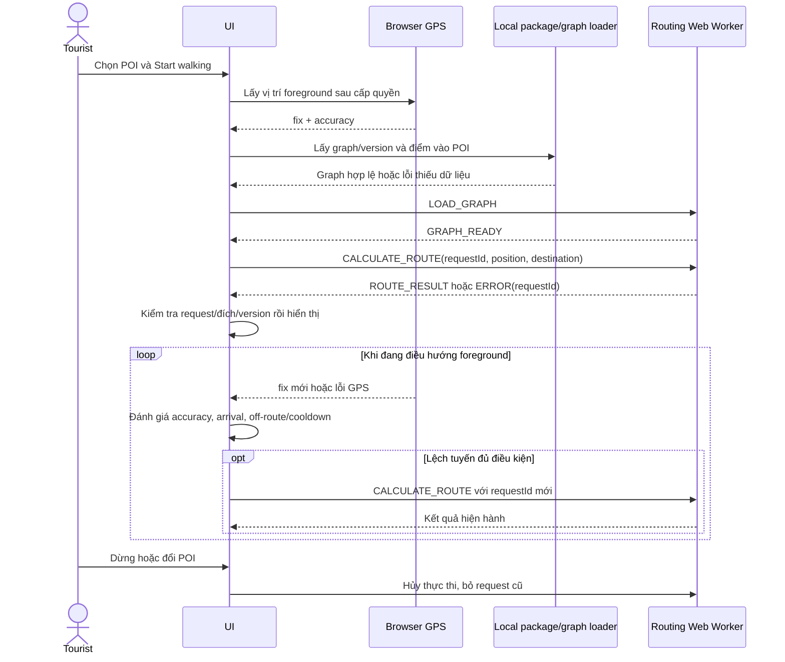

# Vinlook — D-012: hợp đồng và sequence dẫn đường

Ngày 23/10/2026. **ĐÃ DUYỆT tại DEC-072**. Baseline engine và tham số D-011 đã duyệt DEC-071. Truy vết REQ-004–009/025/027, UC-003/005/006/008. Đây là contract thiết kế, chưa phải code sản phẩm.

## 1. Ranh giới xử lý

Vị trí GPS và tính tuyến ở trình duyệt, không gửi tọa độ vào Monitoring. Engine nhận dữ liệu graph hợp lệ theo version; online tải graph cần thiết, offline dùng graph đã lưu. Khi không có graph khả dụng, hiển thị thiếu dữ liệu/Retry thay vì đường thẳng. Không tự thêm dịch vụ routing ngoài hoặc service Express thứ tư.

Đề xuất danh sách POI/nearby khi đã có dữ liệu cục bộ dùng khoảng cách thẳng tại client. Nếu gọi API nearby công khai đã duyệt D-006 thì tọa độ chỉ dùng xử lý request, không lưu/log; navigation không phụ thuộc endpoint này để gửi mọi GPS fix.

## 2. Message UI ↔ Web Worker đề xuất

| Message | Trường chính | Kết quả |
|---|---|---|
| LOAD_GRAPH | requestId, graphVersion, schemaVersion, nguồn dữ liệu local đã kiểm tra | GRAPH_READY hoặc ERROR; không xem callback tải file là graph ready |
| CALCULATE_ROUTE | requestId, graphVersion, position lon/lat, accuracyMeters, destinationPoiId, destinationRevisionId, entrance lon/lat | ROUTE_RESULT hoặc ERROR |
| CANCEL | requestId | Chỉ hủy/bỏ tính toán liên quan; không xóa gói/POI |
| ROUTE_RESULT | requestId, graphVersion, destinationRevisionId, geometry, distanceMeters, instructions, snappedStart, snappedEnd, warnings | UI chỉ nhận khi khớp calculation hiện hành và đích/version |
| ERROR | requestId, code, retryable | Mã: GRAPH_UNAVAILABLE, GRAPH_INCOMPATIBLE, INVALID_POSITION, GPS_UNCERTAIN, SNAP_NOT_FOUND, NO_ROUTE, CALCULATION_FAILED |

Instruction đề xuất gồm maneuver (depart/continue/left/right/u_turn/arrive), vị trí trên geometry, distanceMeters tới bước tiếp theo, streetName nullable, text English. Không tự tạo tên đường khi dữ liệu thiếu; geometry không chứa lịch sử di chuyển. Bản multilingual UI online dịch nhãn thao tác theo danh mục đã duyệt, không gửi vị trí sang dịch vụ dịch để tạo từng instruction.

Route result phải kiểm tra các điểm là số hữu hạn, cùng version và geometry hợp lệ; lỗi dữ liệu không được hiển thị như tuyến thành công. Chưa ấn định format binary graph cuối hoặc giới hạn chunk bằng contract này.

## 3. Điều phối và hủy tính toán

Đề xuất một Worker tính toán hiện hành. Nếu A* đồng bộ chặn event loop thì message CANCEL không đủ ngắt nó: UI phải terminate Worker khi thay đích/hủy tính toán, sau đó khởi tạo lại và nạp graph nếu cần; hoặc sau này chọn thuật toán cooperative yielding đã kiểm chứng. Trong bản đầu đề xuất **terminate/recreate**, đo cả thời gian nạp lại khi tính hiệu năng toàn luồng.

requestId giúp bỏ kết quả lỗi thời, không thay thế hủy công việc thật. Chọn đích mới hoặc dừng điều hướng làm kết quả cũ không còn hợp lệ. Trong khi đang tính lại, các GPS fix mới cập nhật vị trí gần nhất, không tạo nhiều request song song; khi hoàn tất, đánh giá lại fix mới theo cooldown 10 giây của D-011. Chỉ result của request hiện hành được đổi tuyến.

## 4. Sequence

## 5. Trạng thái UI và trường hợp biên

- idle → loading_graph → calculating → navigating; lỗi có lý do và Retry. Không giữ spinner vô hạn nếu worker lỗi.
- gps_unavailable/gps_uncertain giữ tuyến và vị trí cuối, không đánh giá arrival từ fix cũ; phục hồi fix hợp lệ mới tiếp tục. Chỉ accuracy hợp lệ mới cộng bộ đếm lệch tuyến.
- arrived theo ngưỡng D-011: ngừng chỉ dẫn; Play vẫn do người dùng bấm. Không tự phát audio khi tới nơi.
- cancel: ngừng theo dõi GPS dành cho navigation, hủy calculation; nếu chức năng nearby/map vẫn cần GPS thì dùng subscription riêng theo nhu cầu, không tắt tài nguyên của chức năng khác.
- **Đề xuất POI đang dẫn bị xóa khi sync online:** dừng điều hướng, thông báo POI không còn khả dụng, cho chọn POI khác. Không tự đổi destination. Offline chưa biết deletion thì dùng snapshot cho tới sync như PRD.
- **Đề xuất cập nhật gói khi đang dẫn:** giữ graph và destination snapshot hiện hành tới khi dừng/tới nơi; gói mới dùng cho lần tính mới sau đó. Xóa POI đã sync vẫn ưu tiên dừng. Không trộn geometry từ hai graph version hoặc tự reload ứng dụng giữa tuyến.

## 6. Chỉ số cần đo

Đo tổng thời gian user yêu cầu → result hiển thị: load graph nếu cần, snap, A*, instructions và truyền message; ghi riêng cold load và chính sách đo theo PRD. Không lấy thời gian A* 245 ms làm tổng thời gian navigation. Test stale result, đổi đích lúc đang tính, mất GPS, no-route, reroute liên tục và cập nhật gói phải có expected result.

## 7. Phạm vi cần duyệt

1. Contract/message, trạng thái và sequence ở trên, gồm phương án terminate/recreate Worker để hủy thật.
2. Dừng điều hướng nếu POI đích bị xóa khi sync online.
3. Giữ snapshot graph/đích khi đang dẫn và áp gói cập nhật cho phiên điều hướng tiếp theo; không bỏ qua tombstone đã nhận.

Đây là quyết định mới về contract và hành vi biên. Không miễn các test còn mở, thay deadline, bổ sung tracking người dùng hay mở Implementation. Request/response của các service khác, UI wireframes và các phần Design còn lại sẽ trình tiếp.

## Kết quả duyệt — DEC-072

Duy duyệt toàn bộ D-012: contract/sequence/states, terminate/recreate Worker khi cần hủy, dừng navigation khi tombstone đích đã sync, giữ graph/destination snapshot hiện hành và áp gói mới cho lượt tiếp theo. Các gate nghiệm thu và Design tổng thể vẫn mở.
