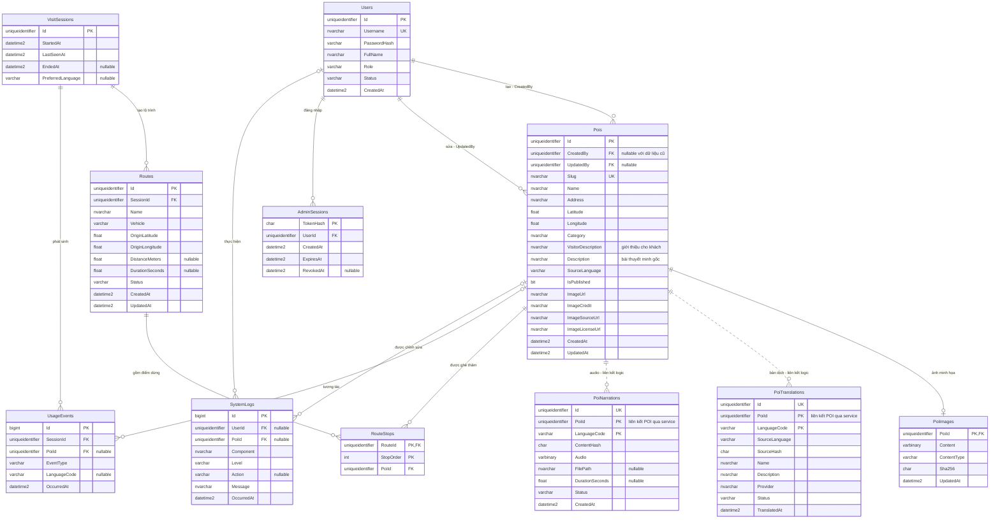

# ERD Vinlook

Thiết kế dựa trên sơ đồ người dùng cung cấp, đã áp dụng bằng migration lên SQL Server local.
Giữ nguyên UUID của POI, nội dung, ảnh, các bản dịch và audio hiện có.

## Sơ đồ quan hệ

Tên trong sơ đồ là tên bảng thực tế. Đường liền biểu diễn khóa ngoại SQL;
đường chấm giữa POI và bản dịch/audio là quan hệ logic qua service, do đang ở hai database.



## Đối chiếu với ERD gốc

| Tên nghiệp vụ | Bảng SQL | Database |
|---|---|---|
| NGUOI_DUNG | Users | PoiDb |
| POI | Pois | PoiDb |
| ẢNH_POI (bổ sung) | PoiImages | PoiDb |
| BAN_DICH | PoiTranslations | TranslationDb |
| AUDIO | PoiNarrations | TranslationDb |
| PHIÊN_TRUY_CẬP (bổ sung) | VisitSessions | PoiDb |
| PHIÊN_ĐĂNG_NHẬP (bổ sung) | AdminSessions | PoiDb |
| LO_TRINH | Routes | PoiDb |
| ĐIỂM_DỪNG_LỘ_TRÌNH (bổ sung) | RouteStops | PoiDb |
| SU_KIEN_SU_DUNG | UsageEvents | PoiDb |
| NHAT_KY_HE_THONG | SystemLogs | PoiDb |

Tổng cộng 11 bảng nghiệp vụ. `SchemaMigrations` là bảng kỹ thuật, không phải thực thể nghiệp vụ.
Chưa gộp hai database; không đổi tên/xóa các bảng hiện có.

## Các điều chỉnh so với ảnh

- Dùng `UNIQUEIDENTIFIER` cho tài khoản, POI, phiên và lộ trình để giữ tương thích dữ liệu hiện tại. Sự kiện và log dùng `BIGINT IDENTITY`.
- SQL Server dùng `NVARCHAR` cho tiếng Việt và `NVARCHAR(MAX)` cho văn bản dài; không dùng kiểu `string`/`text` của sơ đồ khái niệm.
- Tách danh sách POI khỏi JSON thành `RouteStops`, khóa `(RouteId, StopOrder)`. Cho phép cùng POI xuất hiện lại ở vị trí khác, nhưng không trùng thứ tự trong một lộ trình.
- Tách phiên khách khỏi phiên đăng nhập admin; khách không phải có tài khoản mới dùng bản đồ.
- Một POI tối đa một ảnh nhị phân, một bản dịch và một audio hiện hành cho mỗi ngôn ngữ.
- Giữ khóa chính `(PoiId, LanguageCode)` của bản dịch/audio, thêm `Id` duy nhất tương ứng ERD; không tái tạo/xóa cache.
- Audio nhị phân vẫn là dữ liệu được lưu trong DB. `FilePath`/`DurationSeconds` là metadata tùy chọn, chưa backfill cho audio cũ.
- POI cũ không tự gán người tạo để tránh nhận nhầm lịch sử. Các lần tạo/sửa qua dashboard sau migration được gắn tài khoản đã đăng nhập và có log trong cùng transaction.
- Nhật ký có thể không có người dùng hoặc POI khi ghi lỗi hệ thống.

## Trạng thái hợp lệ

| Bảng | Giá trị |
|---|---|
| Users.Role | admin, editor (đăng nhập dashboard hiện chỉ cho admin) |
| Users.Status | active, disabled |
| Pois.IsPublished | 0: bản nháp; 1: xuất bản |
| Routes.Vehicle | driving, motorcycle, walking |
| Routes.Status | planned, active, completed, cancelled |
| UsageEvents.EventType | poi_view, audio_start, audio_pause, audio_end, route_created |
| SystemLogs.Level | info, warning, error |
| PoiTranslations/PoiNarrations.Status | ready, draft, failed |

## Phần đã nối vào ứng dụng

- POI, ảnh, giới thiệu, bản dịch và audio tiếp tục đọc/ghi qua các repository hiện có.
- Đăng nhập đọc `Users` trong DB, kiểm tra trạng thái và vai trò. Chỉ lưu hash scrypt của mật khẩu.
- Phiên đăng nhập lưu hash token trong `AdminSessions`, có hạn 8 giờ, thu hồi khi đăng xuất. Khóa tài khoản có hiệu lực ngay trên các yêu cầu tiếp theo.
- Nhật ký đăng nhập/đăng xuất và tạo/sửa POI đã lưu vào `SystemLogs`.
- `VisitSessions`, `Routes`, `RouteStops`, `UsageEvents` đã có cấu trúc và khóa ngoại; chưa nối luồng tự ghi từ bản đồ vào các bảng này. Dashboard trực tiếp vẫn dùng heartbeat RAM, không suy diễn các bản ghi lịch sử chưa có.

## Migration

```bash
npm run db:migrate
```

- `006_erd_management.sql`: người dùng, phiên, lộ trình, điểm dừng, sự kiện, log và khóa ngoại POI.
- `003_erd_content_metadata.sql`: metadata ERD của bản dịch/audio.
- Sau migrate, seed admin từ `ADMIN_USERNAME`/`ADMIN_PASSWORD_HASH` **chỉ nếu chưa có**. Không reset mật khẩu của tài khoản đã có. Tài khoản local hiện tại vẫn là tài khoản người dùng đã yêu cầu.

## Xem trong SSMS

Refresh `Databases → PoiDb → Tables` và `TranslationDb → Tables`.

```sql
SELECT Id, Username, FullName, Role, Status FROM PoiDb.dbo.Users;
SELECT TOP (50) UserId, PoiId, Component, Level, Action, Message, OccurredAt
FROM PoiDb.dbo.SystemLogs ORDER BY OccurredAt DESC;
SELECT TOP (50) * FROM PoiDb.dbo.Routes ORDER BY CreatedAt DESC;
```

Không đưa `PasswordHash` hoặc `TokenHash` vào API dashboard công khai.
