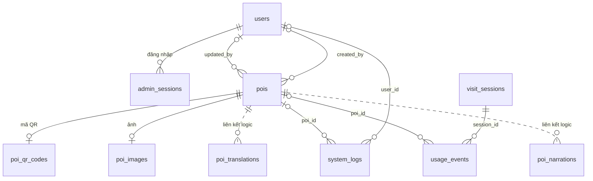

# ERD nghiệp vụ Vinlook

Theo yêu cầu mới: chỉ đường được tính qua API cho lần sử dụng hiện tại; không thiết kế lưu/xem lại lộ trình. DB thực tế đã được tinh gọn còn đúng 10 bảng trong sơ đồ.

Mở hoặc import [erd-business.drawio](erd-business.drawio) bằng draw.io. Sơ đồ gồm **10 bảng**, tên rút gọn, không có kiểu dữ liệu, ký hiệu (PK)/(FK) nằm sau thuộc tính, chữ thuộc tính 20px và tiêu đề 24px.

| Bảng hiển thị | Vai trò |
|---|---|
| users | Tài khoản quản trị |
| admin_sessions | Phiên đăng nhập quản trị |
| pois | Địa điểm và nội dung giới thiệu/thuyết minh |
| poi_images | Ảnh địa điểm |
| visit_sessions | Phiên khách truy cập, không cần đăng nhập |
| usage_events | Sự kiện sử dụng |
| system_logs | Nhật ký hoạt động/lỗi |
| poi_translations | Bản dịch |
| poi_narrations | audio thuyết minh |

Đã xóa khỏi DB: Routes, RouteStops và cả hai SchemaMigrations. Giữ nguyên quan hệ của các bảng còn lại. visit_sessions phục vụ thống kê khách, không phải tài khoản đăng nhập. Khóa ngoại xuyên PoiDb/TranslationDb chưa được khai báo vật lý: đường pois đến bản dịch/audio là nét đứt.

## Luồng chỉ đường

Frontend POST `/api/routes` → gateway → navigation service → Valhalla → kết quả vẽ trên bản đồ. Điểm xuất phát lấy từ vị trí hiện tại hoặc điểm người dùng chọn. Tuyến/điểm dừng chỉ giữ trong trạng thái giao diện, không lưu SQL và không có chức năng xem lại lộ trình đã lưu.

## Cấu trúc vật lý hiện tại

SQL Server hiện có đúng **10 bảng**: PoiDb gồm users, admin_sessions, pois, poi_images, poi_qr_codes, visit_sessions, usage_events, system_logs; TranslationDb gồm poi_translations và poi_narrations. pois trong sơ đồ tương ứng tên vật lý dbo.pois.

Migration 008 xóa RouteStops trước Routes. Lịch sử migration cũ được chuyển nguyên tên và thời điểm sang database extended properties có tiền tố Vinlook.Migration.; không tạo bảng SchemaMigrations nữa. Cơ chế khóa giao dịch vẫn ngăn hai tiến trình chạy trùng migration.

Bản sao lưu trước khi tinh gọn lưu trong .local-backups/erd-1793251789123/, đã chạy RESTORE VERIFYONLY với CHECKSUM và sao chép về máy. Thư mục này được Git bỏ qua. Ảnh, audio, bản dịch, tài khoản và log còn giữ nguyên.

Kiểm tra bảng: npx tsx --env-file=.env database/verify-erd.ts. Kiểm tra tạo DB mới và chạy migration hai lần: npx tsx --env-file=.env database/test-erd-migrations.ts (tạo và dọn hai database thử riêng).

Cấu trúc chi tiết ở [erd-implemented.md](erd-implemented.md). File [erd-exact.sql](../database/erd-exact.sql) chỉ là bản tham khảo 7 bảng ban đầu, không dùng cho schema hiện tại.

## Mã QR địa điểm

Bảng `PoiDb.dbo.poi_qr_codes`: `poi_id` (PK, FK → pois.id), `qr_token` (UNIQUE, bắt buộc, tối đa 128 ký tự, phân biệt hoa/thường), `qr_image_url` (nullable, tối đa 2048 ký tự), `created_at`, `updated_at` (UTC). Mỗi POI có tối đa một QR. Hai thời điểm mặc định là lúc tạo; trigger tự cập nhật `updated_at` khi sửa. Không tự tạo mã hoặc ảnh QR khi chạy migration.

ID thực thể hiện dùng mã ngắn có tiền tố (`POI001`, `USR001`, `VST001`, `TRN001`, `AUD001`). Các khóa ngoại dùng mã tương ứng. Xem [quy tắc ID và nâng cấp](short-ids.md).
