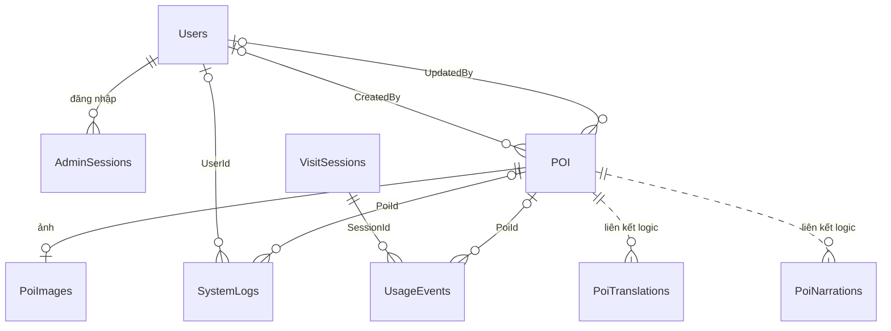

# ERD nghiệp vụ Vinlook

Theo yêu cầu mới: chỉ đường được tính qua API cho lần sử dụng hiện tại; không thiết kế lưu/xem lại lộ trình. Không đưa bảng kỹ thuật quản lý migration vào ERD nghiệp vụ.

Mở hoặc import [erd-business.drawio](erd-business.drawio) bằng draw.io. Sơ đồ gồm **9 bảng**, tên rút gọn, không có kiểu dữ liệu, ký hiệu (PK)/(FK) nằm sau thuộc tính, chữ thuộc tính 20px và tiêu đề 24px.

| Bảng hiển thị | Vai trò |
|---|---|
| Users | Tài khoản quản trị |
| AdminSessions | Phiên đăng nhập quản trị |
| POI | Địa điểm và nội dung giới thiệu/thuyết minh |
| PoiImages | Ảnh địa điểm |
| VisitSessions | Phiên khách truy cập, không cần đăng nhập |
| UsageEvents | Sự kiện sử dụng |
| SystemLogs | Nhật ký hoạt động/lỗi |
| PoiTranslations | Bản dịch |
| PoiNarrations | Audio thuyết minh |

Loại khỏi sơ đồ: Routes, RouteStops và cả hai SchemaMigrations. Giữ nguyên quan hệ của các bảng còn lại. VisitSessions phục vụ thống kê khách, không phải tài khoản đăng nhập. Khóa ngoại xuyên PoiDb/TranslationDb chưa được khai báo vật lý: đường POI đến bản dịch/audio là nét đứt.

## Luồng chỉ đường

Frontend POST `/api/routes` → gateway → navigation service → Valhalla → kết quả vẽ trên bản đồ. Điểm xuất phát lấy từ vị trí hiện tại hoặc điểm người dùng chọn. Tuyến/điểm dừng chỉ giữ trong trạng thái giao diện, không lưu SQL và không có chức năng xem lại lộ trình đã lưu.

## Phân biệt sơ đồ với cấu trúc vật lý

Đây là ERD nghiệp vụ theo phạm vi mới, không phải danh sách toàn bộ bảng vật lý đang tồn tại. Các bảng Routes/RouteStops chưa được dùng và SchemaMigrations vẫn tồn tại trong DB; việc sửa sơ đồ không thực hiện lệnh xóa bảng. Ảnh, audio và phiên đăng nhập tiếp tục hoạt động như hiện tại. Hiện trạng schema trước khi tinh gọn sơ đồ có trong [erd-implemented.md](erd-implemented.md). Bản SQL theo mẫu 7 bảng ban đầu ở [erd-exact.sql](../database/erd-exact.sql) là phương án tham khảo riêng, chưa được áp dụng lên ứng dụng.
